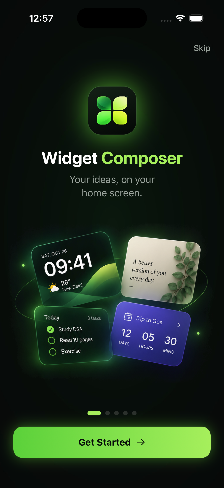
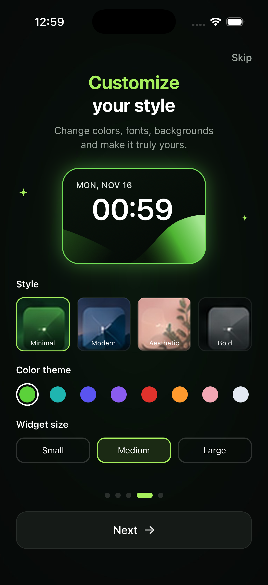
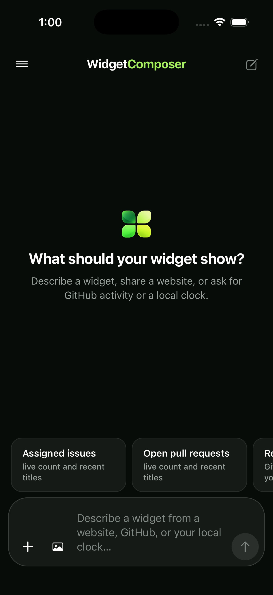
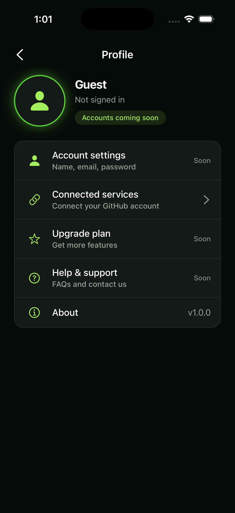
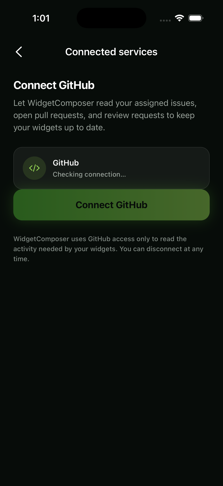

<p align="center">
  
</p>

<h1 align="center">WidgetComposer</h1>

WidgetComposer is a mobile app for creating personalized Android home-screen widgets. Describe what you want in chat, preview and refine the generated widget, then add it to your launcher. Widget definitions are validated data—not generated Android code.

<p>
     
</p>
<p>
     
</p>

## What it does

- Creates, previews, and edits widgets from natural-language prompts.
- Connects widgets to supported live data, including GitHub, public websites, and RSS/Atom news feeds.
- Saves widgets and versions through the WidgetComposer API.
- Renders saved widgets on Android with Jetpack Glance and a fixed, validated component set.
- Refreshes Android widget data through the app or the widget’s background refresh action.

The app interface is built with Expo and React Native. **The home-screen widget runtime is Android-only** and uses a local Kotlin Expo module. iOS can run the app, but this repository does not provide an iOS home-screen widget extension. Expo Go does not include the custom Android widget module; use a development build or the installed app.

## Project structure

```text
src/
  app/                 Expo Router screens
  components/          Reusable UI and widget preview components
  features/             Chat, onboarding, sessions, and home-screen widget flows
  services/             WidgetComposer API client and generated contract types
  theme/                App and widget themes
modules/
  widget-runtime/       Custom Expo module and Android Glance widget runtime
android/                Generated native Android project (ignored by Git)
.github/workflows/      Android APK and iOS Simulator preview builds
```

## Requirements

- Node.js 22 (or a compatible current LTS release) and npm.
- Android Studio and an Android SDK for local Android builds.
- macOS with Xcode for local iOS builds.
- A reachable WidgetComposer API for sign-in, generation, and live widget data.

## Set up the app

```bash
npm ci
cp .env.example .env
```

Set `EXPO_PUBLIC_API_URL` in `.env` to the WidgetComposer API URL. This value is bundled into the app and is public—**never put API keys, passwords, or other secrets in it**.

For local development, the app can use the Expo development server’s host and port `3000` as its API address when `EXPO_PUBLIC_API_URL` is empty. Ensure the API is running and reachable from the phone; connect the phone and development computer to the same network, or use `adb reverse`.

Start the app:

```bash
npm start
```

Build and run the custom Android app:

```bash
npm run android
```

The Android home-screen widget requires this native app build; Expo Go cannot load it. For local iOS app development on macOS, use `npm run ios`. The custom home-screen widget is not available on iOS.

## Preview builds

GitHub Actions builds downloadable previews:

- **Android:** `.github/workflows/android-preview.yml` builds a debug APK on pull requests or when run manually from the Actions tab. Download the `android-preview-*` artifact, then install it on a connected Android device with `adb install app-debug.apk`.
- **iOS Simulator:** `.github/workflows/ios-simulator-preview.yml` builds an unsigned Simulator `.app` on a macOS runner. Download and unzip `ios-simulator-preview-*`, then install the `.app` in a booted iOS Simulator. This is not an IPA and cannot be installed on a physical iPhone or submitted to TestFlight.

Both workflows require the repository Actions variable `EXPO_PUBLIC_API_URL` to be set to an API URL reachable from the device or simulator. The variable is public and is embedded in the preview builds. Workflow artifacts are retained for 14 days.

These are preview builds, not production releases. Android APKs are debug-signed; iOS Simulator builds are unsigned.

## Checks

```bash
npm run lint
npx tsc --noEmit
```
