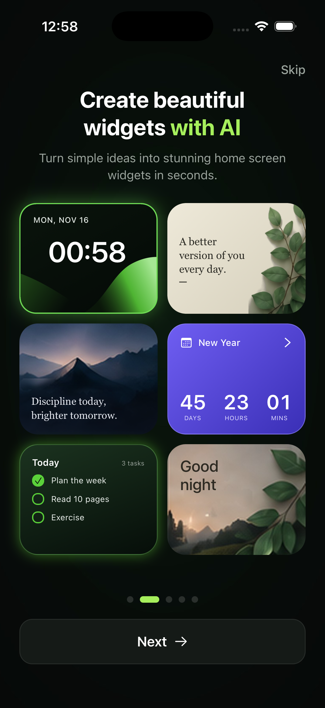
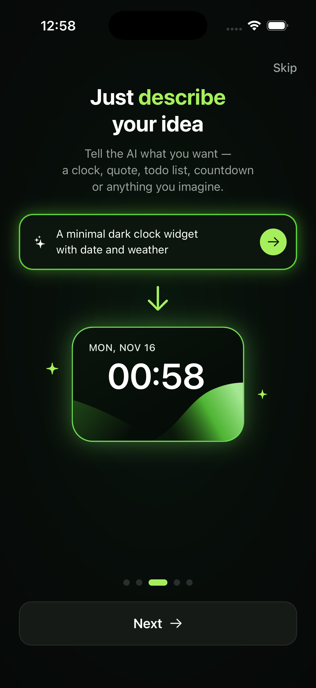
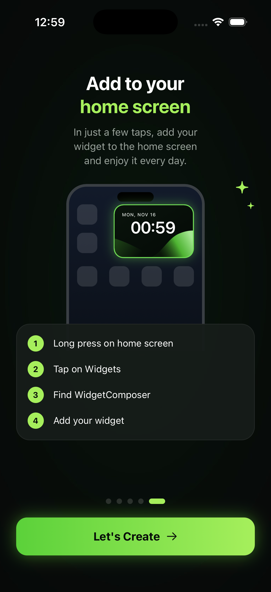

<p align="center">
  
</p>

<h1 align="center">WidgetComposer</h1>

<p align="center">
  Create, customize, and add personalized widgets to your Android home screen.
</p>


<p align="center">
     
</p>
<p align="center">
     
</p>

WidgetComposer turns a natural-language description into a validated widget you can preview and refine in the app. Widgets use a fixed declarative format rather than generated Android code.

## Features

- Create and edit widgets through a chat-style interface.
- Preview widget layouts and customize their appearance.
- Connect widgets to supported live data such as GitHub, public websites, and RSS/Atom feeds.
- Generate, edit, save, and reuse widget artwork in Image Studio.
- Apply saved artwork as an Android widget background while keeping clocks and live data native.
- Save widgets and versions to your WidgetComposer account.
- Add widgets to the Android home screen and refresh their data.

## Platform support

The app interface uses Expo and React Native. Android home-screen widgets are rendered by the included Kotlin module using Jetpack Glance. A native app build is required to use this module; **Expo Go is not supported for home-screen widgets**.

The app can run on iOS, but this project does not currently include an iOS home-screen widget extension. The iOS workflow builds an app for Simulator preview only.

## Getting started

### Prerequisites

- Node.js 22 or a compatible current LTS release
- npm
- Android Studio and Android SDK for Android builds
- macOS and Xcode for local iOS builds
- A reachable WidgetComposer API for sign-in, generation, and live data

### Install dependencies

```bash
npm ci
cp .env.example .env
```

Set `EXPO_PUBLIC_API_URL` in `.env` to the WidgetComposer API base URL. This value is bundled into the app and is public; do not put API keys, passwords, or other secrets in it.

For local development, leave the variable empty to use the Expo development server’s host on port `3000`. The API must be running and reachable from the device. Connect the device and development computer to the same network, or use `adb reverse`.

### Run the app

Start Expo:

```bash
npm start
```

Build and run the custom Android app:

```bash
npm run android
```

On macOS, the app shell can also be run on iOS:

```bash
npm run ios
```

## Project layout

```text
src/
  app/                 Expo Router routes
  components/          Shared UI and widget previews
  features/            Chat, onboarding, sessions, and home-screen flows
  services/            API client and generated widget contract types
  theme/               App and widget themes
modules/
  widget-runtime/      Kotlin Android widget module and Glance renderer
assets/                App icons, UI assets, and screenshots
.github/workflows/     Android and iOS Simulator preview workflows
```

The native `android/` project is generated locally and ignored by Git. Expo prebuild creates it when needed.

## Preview builds

GitHub Actions runs preview builds for pull requests and can also be started manually from the repository’s **Actions** tab:

- **Android APK:** Open the Android preview workflow run and download its `android-preview-*` artifact. It is a debug-signed APK for testing, not a Play Store release.
- **iOS Simulator:** Download the `ios-simulator-preview-*` artifact and unzip it to get the Simulator `.app`. It is not an IPA and cannot be installed on a physical iPhone or submitted to TestFlight.

Set the repository Actions variable `EXPO_PUBLIC_API_URL` to an API URL reachable from the target device or simulator. The value is embedded in the preview app and must not contain secrets. Workflow artifacts are retained for 14 days.

## Development checks

Before opening a pull request, run:

```bash
npm run lint
npx tsc --noEmit
```

## Contributing

Contributions and bug reports are welcome. Before opening a pull request:

1. Create a focused branch for your change.
2. Keep changes scoped and follow the existing TypeScript and Kotlin patterns.
3. Run the lint and type checks above.
4. Describe the behavior changed and include screenshots for visible UI changes.

For bugs, include reproduction steps, expected behavior, actual behavior, and relevant device/OS details. Do not include API credentials or other secrets in issues or pull requests.

## License

See [LICENSE](LICENSE). The current file contains the Expo starter-template MIT license; verify that this is the intended license for this project before redistributing it.
